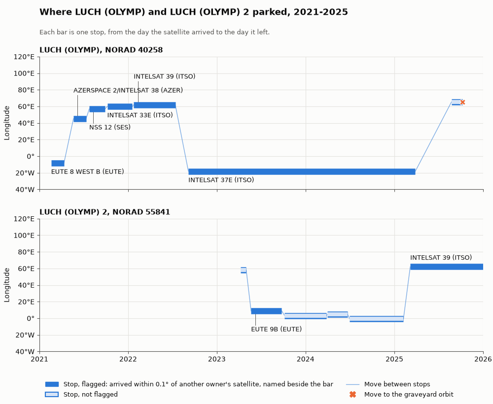

# orbit-watch

Every time an object in the geostationary belt changed how it was being flown, 2021-2025, as a
dated list built only from public orbital elements: 768 changes on 301 of 1,799 objects.

**To use the results, start at [`dataset/`](dataset/README.md):** the changes with object names and
owners, one row per object, a data card with every column and how good the numbers are, and a chart
for each of the top 30 objects.



**One example from the list.** Most objects in the belt never move: 1,646 of the 1,799 started no
relocation in five years, and eight started five or more. Two of the eight are the Russian
satellites LUCH (OLYMP) and LUCH (OLYMP) 2. The list has 13 stops for them, and at 8 the satellite
arrived within 0.1° of another owner's satellite that was already there. The rest of the belt has
27 such arrivals, one each on 27 objects. Analysts who follow the pair from the same public element
sets name the same neighbours: Eutelsat 8 West B in February 2021
([SatTrackCam](https://sattrackcam.blogspot.com/2021/04/luch-olymp-k.html)), Intelsat 37e at 18° W
([RussianSpaceWeb](https://russianspaceweb.com/olymp.html)) and Eutelsat 9B in May 2023
([SatTrackCam](https://sattrackcam.blogspot.com/2024/06/luch-olymp-2-is-on-move-again.html)).
The name on each bar is that neighbour, with its SATCAT owner code. Redraw the chart with
`python tools/stops_chart.py`.

## What is in the list

It reads every published two-line element set (TLE) from 2021 to 2025 for the 1,804 objects in the
GEO region and writes one row for each change. The five objects held out for scoring are left out,
so the list covers 1,799 objects.

| Change | What happened | Rows |
|---|---|---|
| `relocation_start` / `relocation_end` | left its slot / started to hold a new one | 244 / 340 |
| `graveyard` | left its slot and raised its semi-major axis by 150 km or more, with no later hold | 83 |
| `keeping_stop` | stopped east-west station keeping; a later move or climb is its own row | 14 |
| `ns_keeping_stop` | stopped correcting its inclination but kept its longitude | 57 |
| `free_burn` | changed its semi-major axis by 1 km or more after its last hold | 30 |

Each row has the date, the signal that dated it, the size of the change and the longitude before
and after. The list is [`findings/state_changes/events.csv`](findings/state_changes/events.csv).

## How it works

1. **Collect.** From yearly full-catalogue TLE bundles, keep every object with any element set in
   ESA's GEO region (mean motion 0.9-1.1 rev/day, eccentricity at most 0.2, inclination at most 70°).
2. **Clean.** Drop alternate orbit solutions: runs of up to 10 days whose semi-major axis or
   inclination jumps away and comes back while the mean longitude carries on.
3. **Label the mode.** Classify each 30-day window with ESA's classes: held in longitude (with or
   without inclination control), drifting, librating around 75° E, 105° W or both, or inclined.
4. **Find burns.** A step detector looks for steps in the mean semi-major axis against the local
   scatter. Its thresholds were chosen on ISS reboosts and checked on QZSS operator logs.
5. **Date each change.** Where the mode changes, find the day. A departure is the first element
   set that leaves the held drift band or longitude box and stays out for 5 days; the end of
   keeping is the last burn plus half the usual interval between burns.

Every rule, threshold and source is in [orbit_watch/README.md](orbit_watch/README.md).

## Results

| Check | Result |
|---|---|
| Real GEO events from cited public sources, dev split | 13 of 13 found, median date error 2 days |
| The same, held-out test split | 18 of 20 found, median date error 5.5 days |
| 500 relocations planted in held satellites' element sets | at 0.1-3°/day, both ends found in 148 of 150 (dev) and 147 of 150 (test), median date error 0 days; at 0.02-0.1°/day, 89 of 100 and 91 of 100 |
| False events on satellites with published burn logs while on station | 0 in 6.46 object-years (QZS-3, QZS-6, Fengyun-2H) and 0 in 2.15 object-years on the held-out Fengyun-2F and Fengyun-4A |
| 50 events drawn from a frozen copy of the list, judged by hand from the element sets | 47 real with the right type; of the 45 that could be dated, median error 0 days, 42 within 3 days |
| Dated claims from operators and the press, searched for after the list was final (50 objects, 179 searches) | all 9 match, on 7 objects, median date error 1 day, worst 5; no dated claim was found for 38 of the 50 objects |
| ISS burns in 2024-2025, held out from tuning the step detector | all 35 covered NASA and Roscosmos burns found; 35 of 42 detections match a listed burn |

Nine of nine is a small base: the one-sided 95% lower bound on agreement is about 0.72. Analyses
built on the same public element sets are counted apart, and 20 of their 26 claims match.


Each line is one relocation from the list, from its start date and longitude to its end; crosses
mark graveyard moves. Redraw it with `python tools/relocation_chart.py`.

How each number was measured, with the full breakdowns and caveats:
[findings/README.md](findings/README.md), which also lists the leads from the ISS work.

## What did not work: a routine score

The second goal was to rank objects by how far their relocations break their own routine. Each
departure gets a surprise in bits: from the object's earlier stay lengths when it has three of
them, and otherwise from how rarely a held object leaves at all. The targets were set before the
first run, and the score misses most of them:

| Check | Target | Result |
|---|---|---|
| Cited relocation starts scored as off-routine | 90% | 1 of 4 |
| Planted rhythm of four moves, then one on or off it: both read right | 90% | 0.80 of held-out trials |
| Top 30 on the first half of the data in the top 60 on the second | half | 5 of 24 |
| Rank built on data to an earlier date against the final rank (Spearman) | 0.9 | 0.089 to 0.841 |
| Cited irregular objects in the top 5% | 75% | 4 of the 6 that could be rated |
| Off-routine rows on rocket bodies, debris and logged keepers | about 0 | 0 |
| Top 30 judged irregular in a blind hand audit of their charts | 24 | 27 |

The cause is the data, not the model. Five years hold too little history per object: only 33 of
the 197 scored departures have three earlier stays to compare with, and only eight objects get any
score from their own record. They are the same eight that started five or more relocations. For
every other object the score counts how often it left, so the rank is published as what it does
measure, the most active movers ([`dataset/objects.csv`](dataset/objects.csv)):

| Object | Owner code | Relocation starts | Years held | Arrivals beside another owner's satellite |
|---|---|---|---|---|
| HYLAS 1 | UK | 13 | 2.75 | 0 |
| WGS F3 (USA 211) | US | 9 | 3.68 | 0 |
| SJ-17 | PRC | 8 | 3.99 | 0 |
| SJ-20 | PRC | 7 | 4.02 | 0 |
| LUCH (OLYMP) | CIS | 6 | 3.52 | 6 |
| TJS-3 | PRC | 6 | 3.45 | 0 |
| JCSAT 16 | JPN | 6 | 4.26 | 0 |
| LUCH (OLYMP) 2 | CIS | 5 | 2.28 | 2 |

The method and every check are in
[findings/README.md](findings/README.md#routine-score-and-irregularity-rank).

## Known limits

- Very slow moves (0.02-0.05°/day) are missed more often and dated later.
- A move of about half a degree between two nearby positions can be read as one stay.
- A keeping stop on a slow burn cycle can be dated weeks late.
- Near the stable longitudes at 75° E and 105° W a free object barely drifts, so a stop there is
  dated late or missed.
- A change inside a long gap in the element sets is dated at the edge of the gap.

Open limits are tracked as [issues labelled `debt`](../../issues?q=is%3Aissue+is%3Aopen+label%3Adebt).

## Run it

```
python -m venv .venv
.venv/Scripts/python -m pip install -e .[dev]   # .venv/bin/python on Linux/macOS
.venv/Scripts/python -m pytest -q
```

The tests need no data or network. The jobs read and write data in the folder named by the
`ORBIT_WATCH_DATA` environment variable. Every command, what it reads and what it writes:
[docs/features.md](docs/features.md). Download rules and data layout:
[orbit_watch/README.md](orbit_watch/README.md#data-and-downloads).

## Data sources

- Element sets: the yearly full-catalogue bundles of the CC0 Kaggle dataset
  [historical-tle-datasets](https://www.kaggle.com/datasets/vaibhavpandey12382/historical-tle-datasets),
  whose orbital fields match Space-Track's latest-issued element sets on the two objects compared;
  object names and types from the [Space-Track](https://www.space-track.org) SATCAT. ISS history
  from [OndroNR/tle-archive](https://github.com/OndroNR/tle-archive) and Space-Track `gp_history`.
- Mode classes: ESA Space Debris Office, *Classification of Geosynchronous Objects*, Issue 21.0
  (2019).
- Burn logs and cited events: listed with their sources in
  [groundtruth/README.md](groundtruth/README.md).

## License

MIT; see [LICENSE](LICENSE).
