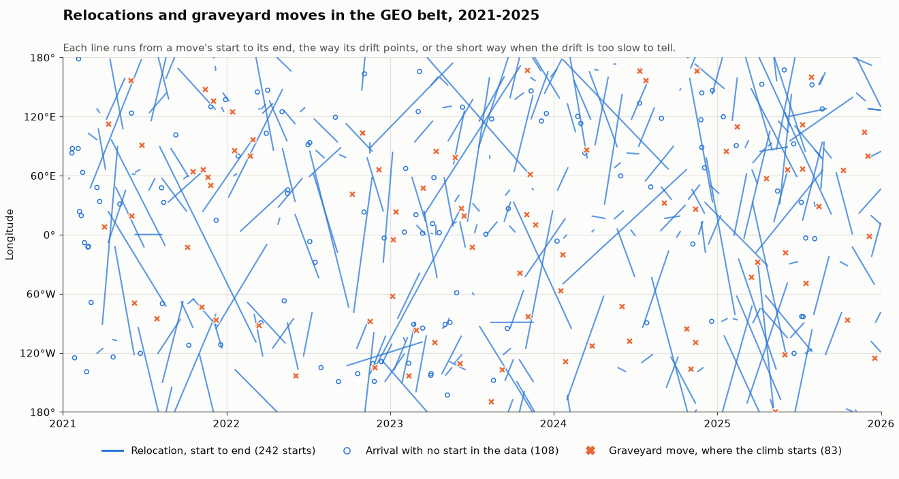

# orbit-watch

A dated list of station-keeping changes for every object in the geostationary belt, 2021-2025,
built only from public orbital elements.



Each line is one relocation from the list, from its start date and longitude to its end date and
longitude. It goes the way the start's `size` says the object drifted when that drift covers more
than 180°, and the short way otherwise. Crosses mark graveyard moves where the climb starts. Redraw
it with `python tools/relocation_chart.py`.

## What it does

It reads every published two-line element set (TLE) from 2021 to 2025 for the 1,804 objects in the
GEO region and writes one row for each time an object changed how it was being flown. The five
objects held out for scoring are left out, so the list covers 1,799 objects.

| Change | What happened |
|---|---|
| `relocation_start` / `relocation_end` | left its slot / started to hold a new one |
| `graveyard` | left its slot and raised its semi-major axis by 150 km or more, with no later hold |
| `keeping_stop` | stopped east-west station keeping; a later move or climb is its own row |
| `ns_keeping_stop` | stopped correcting its inclination but kept its longitude |
| `free_burn` | changed its semi-major axis by 1 km or more after its last hold |

Each row has the date, the signal that dated it, the size of the change and the longitude before
and after. The list is [`findings/state_changes/events.csv`](findings/state_changes/events.csv).

Not built yet: a ranking of the objects that have no real routine.

## How it works

1. **Collect.** Read yearly full-catalogue TLE bundles and keep every object with any element set
   in ESA's GEO region (mean motion 0.9-1.1 rev/day, eccentricity at most 0.2, inclination at most
   70°). When two element sets share an epoch, the later one is kept.
2. **Clean.** Drop snap-back blocks: runs of up to 10 days whose semi-major axis or inclination
   vector jumps away and comes back while the mean longitude carries on. They are alternate orbit
   solutions, not burns.
3. **Label the mode.** Classify each 30-day window with ESA's classes from the mean longitude, the
   drift rate and the inclination: held in longitude (with or without inclination control),
   drifting, librating around 75° E, 105° W or both, or inclined.
4. **Find burns.** A step detector looks for steps in the mean semi-major axis: at each gap
   between element sets it removes one Theil-Sen slope fitted on the 4 sets either side, takes the
   difference of the medians and scores it against the scatter. Its thresholds (robust z at least
   12, step at least 200 m) were chosen on ISS reboosts and checked on QZSS operator logs.
5. **Date each change.** Where the mode changes, find the day. A departure is the first element
   set that leaves the held drift band or longitude box and stays out for 5 days. The end of
   keeping is the last east-west burn plus half the burn interval. The end of north-south keeping
   is the last inclination correction plus half the median interval between corrections. A change
   inside a gap of more than 2 days is placed in the gap by running the first set after it back at
   its drift rate relative to the hold.

Every rule, threshold and source is in [orbit_watch/README.md](orbit_watch/README.md).

## Results

| Check | Result |
|---|---|
| Real GEO events from cited public sources, dev split | 13 of 13 found, median date error 2 days |
| The same, test split | 18 of 20 found, median date error 5 days |
| 500 relocations planted in held satellites' element sets | at 0.1-3°/day, both ends found in 148 of 150 (dev) and 147 of 150 (test), median date error 0 days; at 0.02-0.1°/day, 86 of 100 and 87 of 100 |
| False events on satellites with published burn logs while on station | 0 in 6.46 object-years (QZS-3, QZS-6, Fengyun-2H) and 0 in 2.15 object-years on the held-out Fengyun-2F and Fengyun-4A |
| 50 events drawn from a frozen copy of the list, judged by hand from the element sets; none of the 50 changed in the final list | 47 real with the right type; of the 45 that could be dated, median error 0 days, 42 within 3 days |
| ISS burns in 2024-2025, held out from tuning the step detector | all 35 covered NASA and Roscosmos burns found; 35 of 42 detections match a listed burn |

Across the belt: **764 changes on 301 objects**: 242 relocation starts, 339 relocation ends, 83
graveyard moves, 17 keeping stops, 59 ends of north-south keeping and 24 free burns.

How each number was measured, with the full breakdowns and caveats:
[findings/README.md](findings/README.md), which also lists the leads from the ISS work.

## Known limits

- Very slow moves (0.02-0.05°/day) are missed more often and dated later.
- A keeping stop on a slow burn cycle, or after a small burn, can be dated weeks late.
- Near the stable longitudes at 75° E and 105° W a free object barely drifts, so a stop there is
  dated late or missed.
- A change inside a long gap in the element sets is dated at the edge of the gap.

Open limits are tracked as [issues labelled `debt`](../../issues?q=is%3Aissue+is%3Aopen+label%3Adebt).

## Run it

```
python -m venv .venv
.venv/Scripts/python -m pip install -e .[dev]   # .venv/bin/python on Linux/macOS
.venv/Scripts/python -m pytest -q
```

The tests need no data or network. The jobs read and write data in the folder named by the
`ORBIT_WATCH_DATA` environment variable. Every command, what it reads and what it writes:
[docs/features.md](docs/features.md). Download rules and data layout:
[orbit_watch/README.md](orbit_watch/README.md#data-and-downloads).

## Data sources

- Element sets: the yearly full-catalogue bundles of the CC0 Kaggle dataset
  [historical-tle-datasets](https://www.kaggle.com/datasets/vaibhavpandey12382/historical-tle-datasets),
  whose orbital fields match Space-Track's latest-issued element sets on the two objects compared;
  object names and types from the [Space-Track](https://www.space-track.org) SATCAT. ISS history
  from [OndroNR/tle-archive](https://github.com/OndroNR/tle-archive) and Space-Track `gp_history`.
- Mode classes: ESA Space Debris Office, *Classification of Geosynchronous Objects*, Issue 21.0
  (2019).
- Burn logs and cited events: listed with their sources in
  [groundtruth/README.md](groundtruth/README.md).

## License

MIT; see [LICENSE](LICENSE).
