# Evidence: the top 30 of the irregularity rank

One section per object, in rank order: its standing from [`../objects.csv`](../objects.csv), its state changes from [`../events.csv`](../events.csv), the class a blind judge gave it from its chart (`findings/routine/audit_verdicts.csv`, joined to the rank through `audit_key.csv`) and a chart of its mean longitude. The judge saw an earlier four-panel chart with no ranks or scores. 27 of these 30 were judged irregular; the others are marked below.

In each chart the green bands are the held spans the score uses and each vertical line is one state change, numbered as in the table under it. A number on a red badge is an off-routine departure (5 bits or more). The longitude axis covers the object's holds and listed longitudes; element sets outside it (launch and transfer orbits) are counted in the corner and not drawn.

For an `unclear` object a `departures_real` of `no` means the judge could not see the move on the four-panel chart, whose axes its launch points stretched, not that the move was disproved. The charts here zoom to the object's own longitudes.

- [1. SJ-17 (41838)](#1-sj-17-41838)
- [2. LUCH (OLYMP) (40258)](#2-luch-olymp-40258)
- [3. SJ-20 (44910)](#3-sj-20-44910)
- [4. TJS-3 (43874)](#4-tjs-3-43874)
- [5. WGS F3 (USA 211) (36108)](#5-wgs-f3-usa-211-36108)
- [6. LUCH (OLYMP) 2 (55841)](#6-luch-olymp-2-55841)
- [7. JCSAT 16 (41729)](#7-jcsat-16-41729)
- [8. SYRACUSE 3A (28885)](#8-syracuse-3a-28885)
- [9. TJS-10 (58204)](#9-tjs-10-58204)
- [10. CHINASAT 6C (44067)](#10-chinasat-6c-44067)
- [11. CHINASAT 10 (37677)](#11-chinasat-10-37677)
- [12. INTELSAT 904 (27380)](#12-intelsat-904-27380)
- [13. GAOFEN 13 02 (55912)](#13-gaofen-13-02-55912)
- [14. AEHF 5 (USA 292) (44481)](#14-aehf-5-usa-292-44481)
- [15. TDRS 5 (21639)](#15-tdrs-5-21639)
- [16. HYLAS 2 (38741)](#16-hylas-2-38741)
- [17. USA 170 (27875)](#17-usa-170-27875)
- [18. USA 164 (27168)](#18-usa-164-27168)
- [19. EUTE HOT BIRD 13C (HB 9) (33459)](#19-eute-hot-bird-13c-hb-9-33459)
- [20. GOES 17 (43226)](#20-goes-17-43226)
- [21. SBIRS GEO 4 (USA 273) (41937)](#21-sbirs-geo-4-usa-273-41937)
- [22. EWS-G3 (GOES 14) (35491)](#22-ews-g3-goes-14-35491)
- [23. FENGYUN 4B (48808)](#23-fengyun-4b-48808)
- [24. TDRS 8 (26388)](#24-tdrs-8-26388)
- [25. METEOSAT 12 (MTG I1) (54743)](#25-meteosat-12-mtg-i1-54743)
- [26. AEHF 2 (USA 235) (38254)](#26-aehf-2-usa-235-38254)
- [27. XM-4 (29520)](#27-xm-4-29520)
- [28. HYLAS 1 (37237)](#28-hylas-1-37237)
- [29. EUTELSAT 10B (54259)](#29-eutelsat-10b-54259)
- [30. SBIRS GEO 6 (USA 336) (53355)](#30-sbirs-geo-6-usa-336-53355)

## 1. SJ-17 (41838)

Owner `PRC`, payload. Held 3.986 years. 8.02 bits per year: 3.7 from the stay model and 4.321 from the rate model. Scored departures 8 (off-routine 2), end of life 0, stay overruns 1, proximity flags 0.

Blind audit: `irregular`; listed departures real: `yes`. Judge's note: After 18 months at 116 deg it moved in July 2022, February 2023, July 2023 and January 2024, made two small shifts in 2024, crossed the date line in November 2024 and left again in November 2025 at -1.5 deg/day.

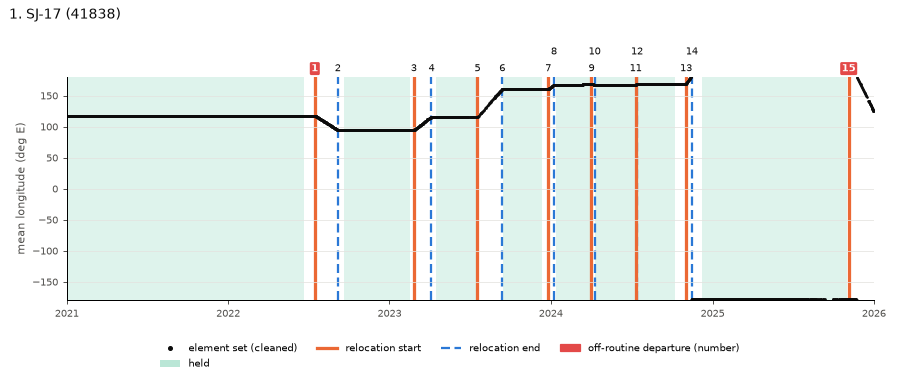

| # | date | type | lon before (deg E) | lon after (deg E) | bits | off-routine | proximity flag |
|---|---|---|---|---|---|---|---|
| 1 | 2022-07-16 | `relocation_start` | 117.5 | 94.185 | 9.088 | yes |  |
| 2 | 2022-09-06 | `relocation_end` | 96.293 | 94.185 |  |  |  |
| 3 | 2023-02-25 | `relocation_start` | 94.185 | 115.312 | 4.862 |  |  |
| 4 | 2023-04-06 | `relocation_end` | 113.653 | 115.312 |  |  |  |
| 5 | 2023-07-19 | `relocation_start` | 115.312 | 160.288 | 4.108 |  |  |
| 6 | 2023-09-13 | `relocation_end` | 156.836 | 160.288 |  |  |  |
| 7 | 2023-12-26 | `relocation_start` | 160.288 | 167.275 | 3.535 |  |  |
| 8 | 2024-01-08 | `relocation_end` | 164.789 | 167.275 |  |  |  |
| 9 | 2024-04-02 | `relocation_start` | 168.004 | 167.212 | 2.238 |  |  |
| 10 | 2024-04-09 | `relocation_end` | 168.054 | 167.212 |  |  |  |
| 11 | 2024-07-11 | `relocation_start` | 167.212 | 169.304 | 1.571 |  |  |
| 12 | 2024-07-14 | `relocation_end` | 167.168 | 169.304 |  |  |  |
| 13 | 2024-11-02 | `relocation_start` | 169.304 | -177.944 | 1.395 |  |  |
| 14 | 2024-11-15 | `relocation_end` | 176.071 | -177.944 |  |  |  |
| 15 | 2025-11-05 | `relocation_start` | -177.944 | 130.462 | 13.288 | yes |  |

## 2. LUCH (OLYMP) (40258)

Owner `CIS`, payload. Held 3.515 years. 7.755 bits per year: 6.445 from the stay model and 1.309 from the rate model. Scored departures 5 (off-routine 3), end of life 1, stay overruns 3, proximity flags 6.

Blind audit: `irregular`; listed departures real: `yes`. Judge's note: Several uneven moves in 2021 and 2022 are followed by a hold at -20 deg of two and a half years, a slow move to +67 deg in 2025 and a climb to 330 km above GEO in October 2025.

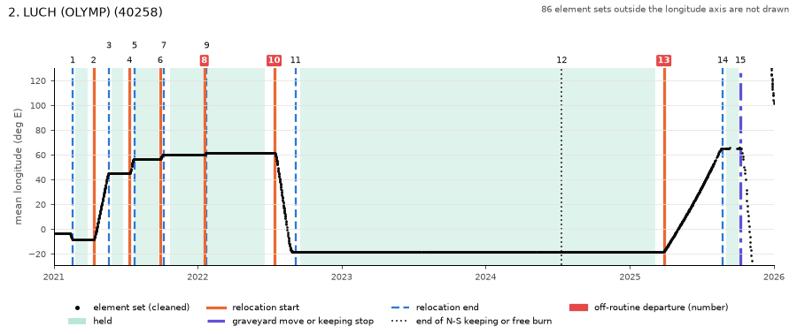

| # | date | type | lon before (deg E) | lon after (deg E) | bits | off-routine | proximity flag |
|---|---|---|---|---|---|---|---|
| 1 | 2021-02-18 | `relocation_end` | -3.778 | -8.08 |  |  | yes, near 40875 |
| 2 | 2021-04-12 | `relocation_start` | -8.08 | 45.191 | 7.721 |  |  |
| 3 | 2021-05-21 | `relocation_end` | 41.263 | 45.191 |  |  | yes, near 43632 |
| 4 | 2021-07-12 | `relocation_start` | 45.191 | 56.907 | 4.03 |  |  |
| 5 | 2021-07-25 | `relocation_end` | 55.057 | 56.907 |  |  | yes, near 36032 |
| 6 | 2021-09-28 | `relocation_start` | 56.907 | 59.959 | 2.313 |  |  |
| 7 | 2021-10-07 | `relocation_end` | 59.539 | 59.959 |  |  | yes, near 41748 |
| 8 | 2022-01-18 | `relocation_start` | 59.959 | 61.875 | 9.388 | yes |  |
| 9 | 2022-01-24 | `relocation_end` | 60.324 | 61.875 |  |  | yes, near 44476 |
| 10 | 2022-07-14 | `relocation_start` | 61.875 | -18.109 | 8.55 | yes |  |
| 11 | 2022-09-06 | `relocation_end` | -18.201 | -18.109 |  |  | yes, near 42950 |
| 12 | 2024-07-12 | `ns_keeping_stop` | -18.109 | -18.096 |  |  |  |
| 13 | 2025-03-28 | `relocation_start` | -18.096 | 65.521 | 13.288 | yes |  |
| 14 | 2025-08-24 | `relocation_end` | 64.616 | 65.521 |  |  |  |
| 15 | 2025-10-08 | `graveyard` | 65.521 | 119.177 |  |  |  |

## 3. SJ-20 (44910)

Owner `PRC`, payload. Held 4.023 years. 6.792 bits per year: 3.041 from the stay model and 3.751 from the rate model. Scored departures 7 (off-routine 1), end of life 0, stay overruns 0, proximity flags 0.

Blind audit: `irregular`; listed departures real: `yes`. Judge's note: Seven real moves between 33 and 88 deg start in May 2022, June 2023, September 2023, January 2024, May 2024, March 2025 and September 2025, so the gaps run from 3 to 13 months.

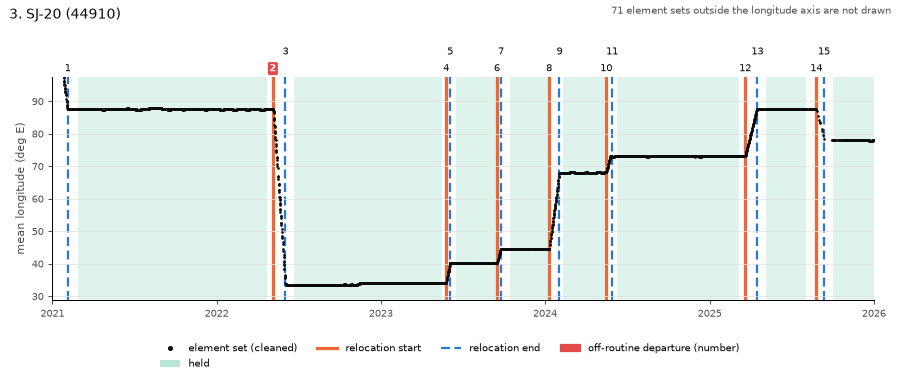

| # | date | type | lon before (deg E) | lon after (deg E) | bits | off-routine | proximity flag |
|---|---|---|---|---|---|---|---|
| 1 | 2021-02-04 | `relocation_end` | 92.718 | 87.469 |  |  |  |
| 2 | 2022-05-06 | `relocation_start` | 87.442 | 33.512 | 9.125 | yes |  |
| 3 | 2022-06-03 | `relocation_end` | 40.683 | 33.512 |  |  |  |
| 4 | 2023-05-26 | `relocation_start` | 34.023 | 40.168 | 4.997 |  |  |
| 5 | 2023-06-04 | `relocation_end` | 37.517 | 40.168 |  |  |  |
| 6 | 2023-09-16 | `relocation_start` | 40.168 | 44.566 | 4.047 |  |  |
| 7 | 2023-09-25 | `relocation_end` | 42.356 | 44.566 |  |  |  |
| 8 | 2024-01-10 | `relocation_start` | 44.478 | 68.028 | 3.714 |  |  |
| 9 | 2024-02-02 | `relocation_end` | 63.447 | 68.028 |  |  |  |
| 10 | 2024-05-16 | `relocation_start` | 68.028 | 73.031 | 3.326 |  |  |
| 11 | 2024-05-29 | `relocation_end` | 72.879 | 73.031 |  |  |  |
| 12 | 2025-03-21 | `relocation_start` | 73.031 | 87.593 | 4.521 |  |  |
| 13 | 2025-04-17 | `relocation_end` | 85.128 | 87.593 |  |  |  |
| 14 | 2025-08-26 | `relocation_start` | 87.593 | 77.982 | 3.172 |  |  |
| 15 | 2025-09-12 | `relocation_end` | 81.118 | 77.982 |  |  |  |

## 4. TJS-3 (43874)

Owner `PRC`, payload. Held 3.449 years. 6.342 bits per year: 2.944 from the stay model and 3.397 from the rate model. Scored departures 6 (off-routine 2), end of life 0, stay overruns 0, proximity flags 0.

Blind audit: `irregular`; listed departures real: `yes`. Judge's note: Six real moves between 50 and 175 deg start in September 2021, July 2022, November 2022, March 2023, November 2024 and March 2025, so the gaps run from 4 to 20 months.

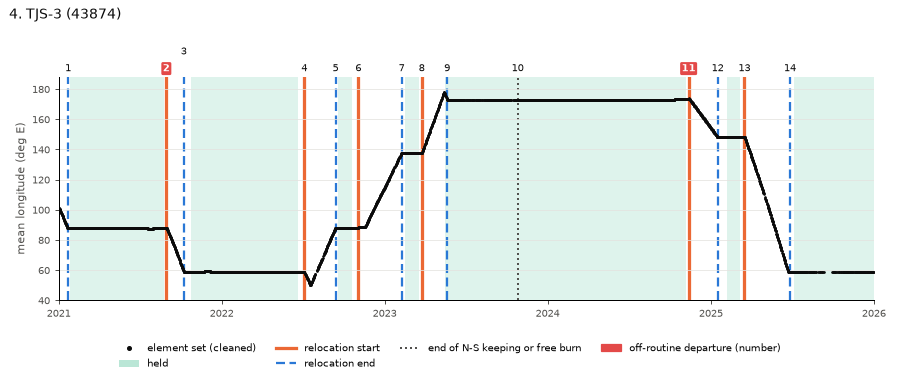

| # | date | type | lon before (deg E) | lon after (deg E) | bits | off-routine | proximity flag |
|---|---|---|---|---|---|---|---|
| 1 | 2021-01-22 | `relocation_end` | 90.207 | 87.616 |  |  |  |
| 2 | 2021-08-30 | `relocation_start` | 87.616 | 59.108 | 8.731 | yes |  |
| 3 | 2021-10-08 | `relocation_end` | 62.551 | 59.108 |  |  |  |
| 4 | 2022-07-05 | `relocation_start` | 59.108 | 88.26 | 4.451 |  |  |
| 5 | 2022-09-13 | `relocation_end` | 85.355 | 88.26 |  |  |  |
| 6 | 2022-11-03 | `relocation_start` | 88.26 | 137.454 | 3.557 |  |  |
| 7 | 2023-02-08 | `relocation_end` | 135.218 | 137.454 |  |  |  |
| 8 | 2023-03-25 | `relocation_start` | 137.454 | 174.308 | 3.715 |  |  |
| 9 | 2023-05-21 | `relocation_end` | 176.548 | 174.308 |  |  |  |
| 10 | 2023-10-26 | `ns_keeping_stop` | 173.021 | 172.992 |  |  |  |
| 11 | 2024-11-12 | `relocation_start` | 173.437 | 148.429 | 7.513 | yes |  |
| 12 | 2025-01-16 | `relocation_end` | 149.805 | 148.429 |  |  |  |
| 13 | 2025-03-17 | `relocation_start` | 148.429 | 59.003 | 3.281 |  |  |
| 14 | 2025-06-27 | `relocation_end` | 60.103 | 59.003 |  |  |  |

## 5. WGS F3 (USA 211) (36108)

Owner `US`, payload. Held 3.684 years. 6.106 bits per year: 4.214 from the stay model and 1.893 from the rate model. Scored departures 8 (off-routine 1), end of life 0, stay overruns 1, proximity flags 0.

Blind audit: `irregular`; listed departures real: `yes`. Judge's note: Nine real moves of tens of degrees come four to six months apart in 2021 to 2023, but a 17 month hold at -43 deg from April 2023 to August 2024 breaks the cadence before two more moves in 2025.

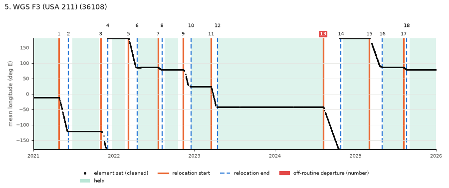

| # | date | type | lon before (deg E) | lon after (deg E) | bits | off-routine | proximity flag |
|---|---|---|---|---|---|---|---|
| 1 | 2021-04-27 | `relocation_start` | -12.027 | -121.9 | 7.721 |  |  |
| 2 | 2021-06-09 | `relocation_end` | -119.987 | -121.9 |  |  |  |
| 3 | 2021-11-02 | `relocation_start` | -121.9 | 179.799 | 3.57 |  |  |
| 4 | 2021-12-04 | `relocation_end` | -176.4 | 179.799 |  |  |  |
| 5 | 2022-03-08 | `relocation_start` | 179.799 | 85.635 | 3.054 |  |  |
| 6 | 2022-04-16 | `relocation_end` | 88.936 | 85.635 |  |  |  |
| 7 | 2022-07-20 | `relocation_start` | 85.635 | 78.115 | 2.837 |  |  |
| 8 | 2022-08-07 | `relocation_end` | 79.482 | 78.115 |  |  |  |
| 9 | 2022-11-11 | `relocation_start` | 78.115 | 23.993 | 1.292 |  |  |
| 10 | 2022-12-17 | `relocation_end` | 24.337 | 23.993 |  |  |  |
| 11 | 2023-03-18 | `relocation_start` | 23.993 | -42.789 | 1.178 |  |  |
| 12 | 2023-04-16 | `relocation_end` | -42.037 | -42.789 |  |  |  |
| 13 | 2024-08-07 | `relocation_start` | -42.809 | 179.781 | 13.288 | yes |  |
| 14 | 2024-10-27 | `relocation_end` | 179.792 | 179.781 |  |  |  |
| 15 | 2025-03-05 | `relocation_start` | 179.781 | 86.011 | 2.819 |  |  |
| 16 | 2025-05-03 | `relocation_end` | 88.013 | 86.011 |  |  |  |
| 17 | 2025-08-07 | `relocation_start` | 86.011 | 78.256 | 2.482 |  |  |
| 18 | 2025-08-21 | `relocation_end` | 80.887 | 78.256 |  |  |  |

## 6. LUCH (OLYMP) 2 (55841)

Owner `CIS`, payload. Held 2.28 years. 5.131 bits per year: 2.883 from the stay model and 2.248 from the rate model. Scored departures 4 (off-routine 0), end of life 0, stay overruns 0, proximity flags 2.

Blind audit: `irregular`; listed departures real: `yes`. Judge's note: Five real moves start in May 2023, September 2023, March 2024, June 2024 and February 2025, ranging from 2 deg steps near 3 deg to jumps of about 50 and 63 deg.

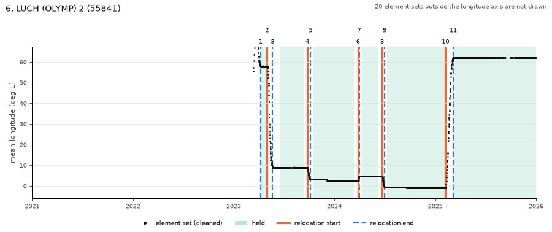

| # | date | type | lon before (deg E) | lon after (deg E) | bits | off-routine | proximity flag |
|---|---|---|---|---|---|---|---|
| 1 | 2023-04-09 | `relocation_end` | 59.774 | 58.005 |  |  |  |
| 2 | 2023-05-02 | `relocation_start` | 58.005 | 8.875 | 7.436 |  |  |
| 3 | 2023-05-22 | `relocation_end` | 12.291 | 8.875 |  |  | yes, near 41310 |
| 4 | 2023-09-25 | `relocation_start` | 8.875 | 3.218 | 3.081 |  |  |
| 5 | 2023-10-07 | `relocation_end` | 3.533 | 3.218 |  |  |  |
| 6 | 2024-03-27 | `relocation_start` | 2.622 | 4.714 | 3.056 |  |  |
| 7 | 2024-03-31 | `relocation_end` | 2.733 | 4.714 |  |  |  |
| 8 | 2024-06-22 | `relocation_start` | 4.714 | -0.753 | 2.9 |  |  |
| 9 | 2024-07-01 | `relocation_end` | 2.275 | -0.753 |  |  |  |
| 10 | 2025-02-07 | `relocation_start` | -0.753 | 62.008 | 4.97 |  |  |
| 11 | 2025-03-07 | `relocation_end` | 60.516 | 62.008 |  |  | yes, near 44476 |

## 7. JCSAT 16 (41729)

Owner `JPN`, payload. Held 4.259 years. 5.119 bits per year: 3.191 from the stay model and 1.928 from the rate model. Scored departures 5 (off-routine 1), end of life 0, stay overruns 2, proximity flags 0.

Blind audit: `irregular`; listed departures real: `yes`. Judge's note: Six real moves between 93 and 144 deg start in March 2021, July 2021, January 2022, April 2022, May 2023 and October 2023, followed by more than two years held at 144 deg.

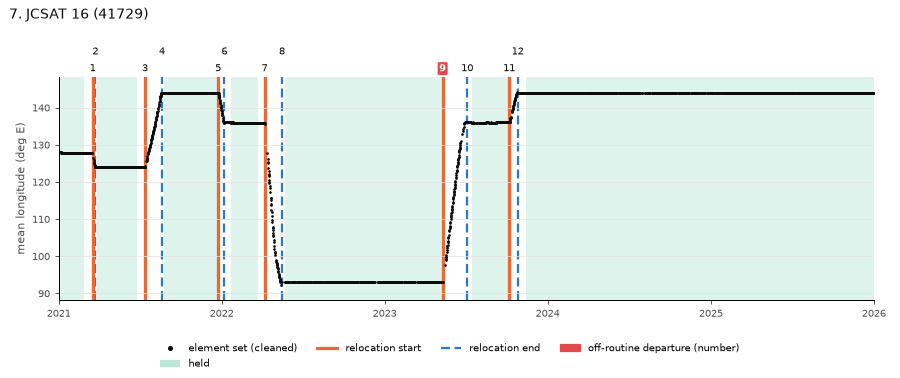

| # | date | type | lon before (deg E) | lon after (deg E) | bits | off-routine | proximity flag |
|---|---|---|---|---|---|---|---|
| 1 | 2021-03-18 | `relocation_start` | 127.904 | 123.994 | 8.931 |  |  |
| 2 | 2021-03-24 | `relocation_end` | 125.197 | 123.994 |  |  |  |
| 3 | 2021-07-13 | `relocation_start` | 123.994 | 143.967 | 4.244 |  |  |
| 4 | 2021-08-20 | `relocation_end` | 142.459 | 143.967 |  |  |  |
| 5 | 2021-12-24 | `relocation_start` | 143.967 | 135.965 | 2.833 |  |  |
| 6 | 2022-01-07 | `relocation_end` | 138.311 | 135.965 |  |  |  |
| 7 | 2022-04-07 | `relocation_start` | 135.965 | 93.033 | 2.561 |  |  |
| 8 | 2022-05-16 | `relocation_end` | 94.136 | 93.033 |  |  |  |
| 9 | 2023-05-11 | `relocation_start` | 93.022 | 135.984 | 13.288 | yes |  |
| 10 | 2023-07-05 | `relocation_end` | 136.048 | 135.984 |  |  |  |
| 11 | 2023-10-07 | `relocation_start` | 136.019 | 143.955 | 2.661 |  |  |
| 12 | 2023-10-26 | `relocation_end` | 142.653 | 143.955 |  |  |  |

## 8. SYRACUSE 3A (28885)

Owner `FR`, payload. Held 4.743 years. 4.214 bits per year: 0.0 from the stay model and 4.214 from the rate model. Scored departures 3 (off-routine 2), end of life 0, stay overruns 0, proximity flags 0.

Blind audit: `irregular`; listed departures real: `yes`. Judge's note: It shifted 0.8 deg in November 2023, moved from 46 to 22 deg in November 2024 and returned to 46 deg in November 2025 after almost three years of holding 47 deg.

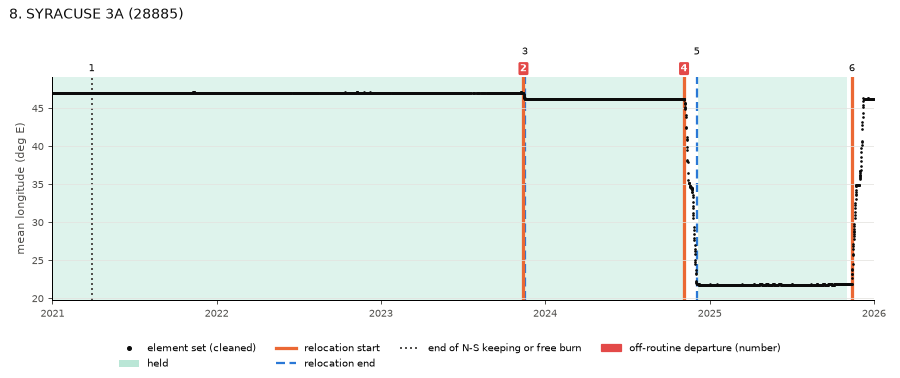

| # | date | type | lon before (deg E) | lon after (deg E) | bits | off-routine | proximity flag |
|---|---|---|---|---|---|---|---|
| 1 | 2021-03-29 | `ns_keeping_stop` | 46.997 | 47.011 |  |  |  |
| 2 | 2023-11-14 | `relocation_start` | 47.011 | 46.217 | 10.346 | yes |  |
| 3 | 2023-11-17 | `relocation_end` | 47.029 | 46.217 |  |  |  |
| 4 | 2024-11-05 | `relocation_start` | 46.238 | 21.811 | 5.715 | yes |  |
| 5 | 2024-12-03 | `relocation_end` | 27.904 | 21.811 |  |  |  |
| 6 | 2025-11-13 | `relocation_start` | 21.811 | 46.19 | 4.993 |  |  |

## 9. TJS-10 (58204)

Owner `PRC`, payload. Held 2.124 years. 3.787 bits per year: 0.0 from the stay model and 3.787 from the rate model. Scored departures 1 (off-routine 1), end of life 0, stay overruns 0, proximity flags 0.

**Not judged irregular by the blind audit: `unclear`.**

Blind audit: `unclear`; listed departures real: `no`. Judge's note: The launch points stretch every axis, so the object looks flat at about 174 deg from late 2023 and the listed May 2024 move leaves no visible trace, but a move under about 3 deg would not show at this scale.

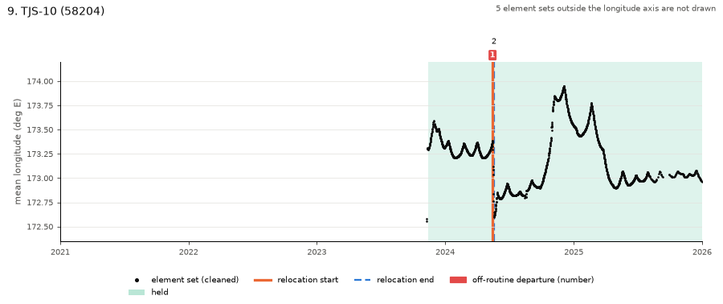

| # | date | type | lon before (deg E) | lon after (deg E) | bits | off-routine | proximity flag |
|---|---|---|---|---|---|---|---|
| 1 | 2024-05-15 | `relocation_start` | 173.295 | 172.73 | 8.085 | yes |  |
| 2 | 2024-05-19 | `relocation_end` | 173.321 | 172.73 |  |  |  |

## 10. CHINASAT 6C (44067)

Owner `PRC`, payload. Held 4.752 years. 3.568 bits per year: 0.0 from the stay model and 3.568 from the rate model. Scored departures 3 (off-routine 1), end of life 0, stay overruns 0, proximity flags 0.

Blind audit: `irregular`; listed departures real: `yes`. Judge's note: It moved from 130 to 125 deg in December 2021, back to 130 deg in June 2022 and shifted to 130.5 deg through a 2 deg excursion in April 2023, then held for over two years.

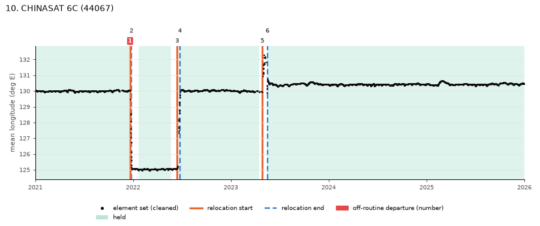

| # | date | type | lon before (deg E) | lon after (deg E) | bits | off-routine | proximity flag |
|---|---|---|---|---|---|---|---|
| 1 | 2021-12-21 | `relocation_start` | 130.007 | 125.013 | 9.254 | yes |  |
| 2 | 2021-12-26 | `relocation_end` | 129.016 | 125.013 |  |  |  |
| 3 | 2022-06-15 | `relocation_start` | 125.013 | 129.097 | 4.491 |  |  |
| 4 | 2022-06-25 | `relocation_end` | 128.608 | 129.097 |  |  |  |
| 5 | 2023-04-29 | `relocation_start` | 129.971 | 130.535 | 4.088 |  |  |
| 6 | 2023-05-18 | `relocation_end` | 130.698 | 130.535 |  |  |  |

## 11. CHINASAT 10 (37677)

Owner `PRC`, payload. Held 4.671 years. 3.215 bits per year: 0.0 from the stay model and 3.215 from the rate model. Scored departures 2 (off-routine 2), end of life 0, stay overruns 0, proximity flags 0.

Blind audit: `irregular`; listed departures real: `yes`. Judge's note: It held 110.5 deg until June 2025, moved to 76.5 deg by August 2025, stayed about three months and left again in December 2025 at +0.25 deg/day.

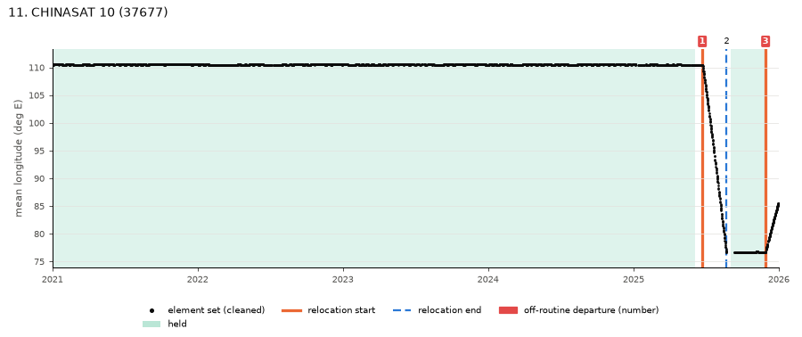

| # | date | type | lon before (deg E) | lon after (deg E) | bits | off-routine | proximity flag |
|---|---|---|---|---|---|---|---|
| 1 | 2025-06-23 | `relocation_start` | 110.487 | 76.666 | 10.136 | yes |  |
| 2 | 2025-08-23 | `relocation_end` | 79.2 | 76.666 |  |  |  |
| 3 | 2025-11-29 | `relocation_start` | 76.717 | 84.427 | 5.928 | yes |  |

## 12. INTELSAT 904 (27380)

Owner `ITSO`, payload. Held 4.834 years. 3.214 bits per year: 0.0 from the stay model and 3.214 from the rate model. Scored departures 2 (off-routine 2), end of life 0, stay overruns 0, proximity flags 0.

Blind audit: `irregular`; listed departures real: `yes`. Judge's note: After four and a half years at -29.5 deg it moved 2 deg east in June 2025 and then 4 deg west to -31.5 deg in October 2025.

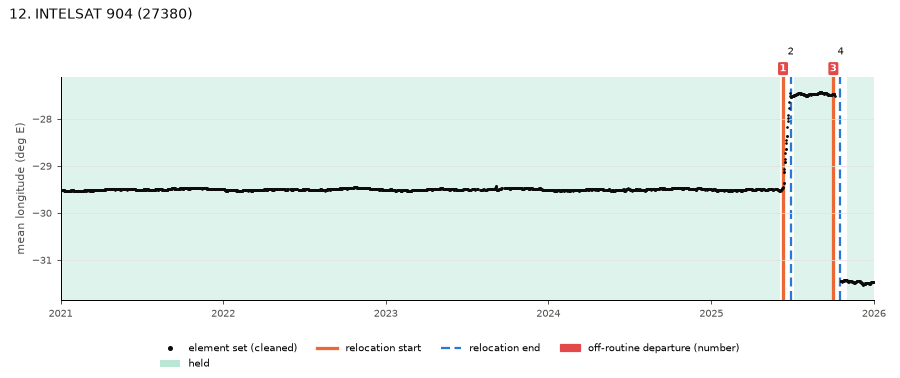

| # | date | type | lon before (deg E) | lon after (deg E) | bits | off-routine | proximity flag |
|---|---|---|---|---|---|---|---|
| 1 | 2025-06-11 | `relocation_start` | -29.486 | -27.478 | 10.136 | yes |  |
| 2 | 2025-06-28 | `relocation_end` | -27.912 | -27.478 |  |  |  |
| 3 | 2025-10-02 | `relocation_start` | -27.478 | -31.488 | 5.926 | yes |  |
| 4 | 2025-10-18 | `relocation_end` |  | -31.488 |  |  |  |

## 13. GAOFEN 13 02 (55912)

Owner `PRC`, payload. Held 2.785 years. 3.206 bits per year: 0.0 from the stay model and 3.206 from the rate model. Scored departures 1 (off-routine 1), end of life 0, stay overruns 0, proximity flags 0.

**Not judged irregular by the blind audit: `unclear`.**

Blind audit: `unclear`; listed departures real: `no`. Judge's note: The launch points stretch the longitude axis over 300 deg, so the listed October 2024 move shows only as a wobble of a few degrees near 147 deg going flat and a move under about 3 deg cannot be confirmed or ruled out.

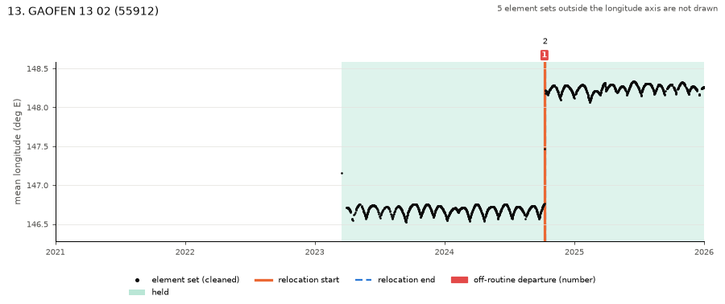

| # | date | type | lon before (deg E) | lon after (deg E) | bits | off-routine | proximity flag |
|---|---|---|---|---|---|---|---|
| 1 | 2024-10-09 | `relocation_start` | 146.664 | 148.201 | 8.948 | yes |  |
| 2 | 2024-10-11 | `relocation_end` | 146.742 | 148.201 |  |  |  |

## 14. AEHF 5 (USA 292) (44481)

Owner `US`, payload. Held 4.67 years. 3.178 bits per year: 0.0 from the stay model and 3.178 from the rate model. Scored departures 2 (off-routine 2), end of life 0, stay overruns 0, proximity flags 1.

Blind audit: `irregular`; listed departures real: `yes`. Judge's note: After three and a half years at 54.5 deg it moved to 90 deg between July and October 2024 at 0.55 deg/day and stepped a further 3 deg east in April 2025.

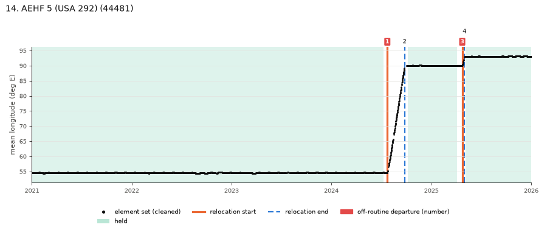

| # | date | type | lon before (deg E) | lon after (deg E) | bits | off-routine | proximity flag |
|---|---|---|---|---|---|---|---|
| 1 | 2024-07-24 | `relocation_start` | 54.552 | 89.999 | 10.144 | yes |  |
| 2 | 2024-09-25 | `relocation_end` | 86.974 | 89.999 |  |  | yes, near 40345 |
| 3 | 2025-04-24 | `relocation_start` | 89.999 | 93.047 | 5.741 | yes |  |
| 4 | 2025-05-02 | `relocation_end` | 90.606 | 93.047 |  |  |  |

## 15. TDRS 5 (21639)

Owner `US`, payload. Held 4.259 years. 3.166 bits per year: 0.0 from the stay model and 3.166 from the rate model. Scored departures 2 (off-routine 2), end of life 0, stay overruns 0, proximity flags 0.

Blind audit: `irregular`; listed departures real: `yes`. Judge's note: After three years at -169 deg it moved to -62 deg in February 2024 at 1.35 deg/day, stayed nine months and returned to -169 deg between February and May 2025.

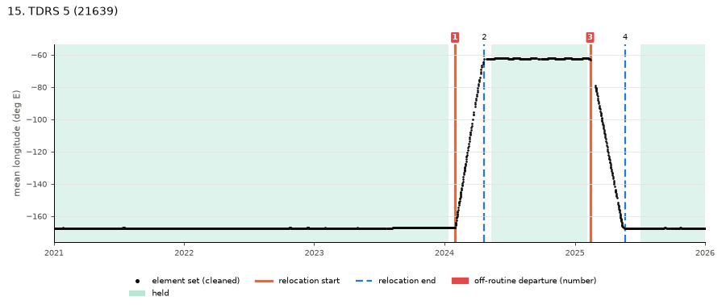

| # | date | type | lon before (deg E) | lon after (deg E) | bits | off-routine | proximity flag |
|---|---|---|---|---|---|---|---|
| 1 | 2024-01-31 | `relocation_start` | -167.243 | -62.328 | 10.137 | yes |  |
| 2 | 2024-04-22 | `relocation_end` | -65.964 | -62.328 |  |  |  |
| 3 | 2025-02-13 | `relocation_start` | -62.413 | -167.441 | 5.69 | yes |  |
| 4 | 2025-05-22 | `relocation_end` | -165.674 | -167.441 |  |  |  |

## 16. HYLAS 2 (38741)

Owner `UK`, payload. Held 4.505 years. 3.14 bits per year: 0.0 from the stay model and 3.14 from the rate model. Scored departures 2 (off-routine 2), end of life 0, stay overruns 0, proximity flags 0.

Blind audit: `irregular`; listed departures real: `yes`. Judge's note: After holding 30 deg for over three years it moved to about 140 deg in April 2024 and then on to about -75 deg between December 2024 and March 2025, and it is held again afterwards.

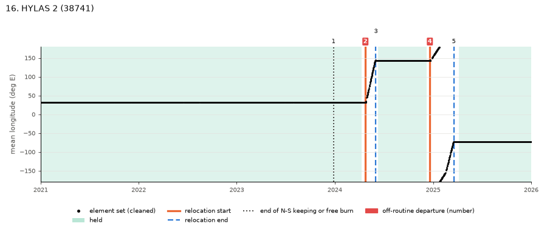

| # | date | type | lon before (deg E) | lon after (deg E) | bits | off-routine | proximity flag |
|---|---|---|---|---|---|---|---|
| 1 | 2023-12-27 | `ns_keeping_stop` | 31.038 | 31.032 |  |  |  |
| 2 | 2024-04-24 | `relocation_start` | 31.032 | 142.503 | 9.996 | yes |  |
| 3 | 2024-06-02 | `relocation_end` | 135.905 | 142.503 |  |  |  |
| 4 | 2024-12-20 | `relocation_start` | 142.503 | -72.516 | 5.697 | yes |  |
| 5 | 2025-03-19 | `relocation_end` | -84.617 | -72.516 |  |  |  |

## 17. USA 170 (27875)

Owner `US`, payload. Held 4.421 years. 3.117 bits per year: 0.0 from the stay model and 3.117 from the rate model. Scored departures 2 (off-routine 2), end of life 0, stay overruns 0, proximity flags 0.

Blind audit: `irregular`; listed departures real: `yes`. Judge's note: After nearly three years at -42 deg it moved to +16 deg between November 2023 and January 2024, stayed four months and moved on to +24 deg in May 2024.

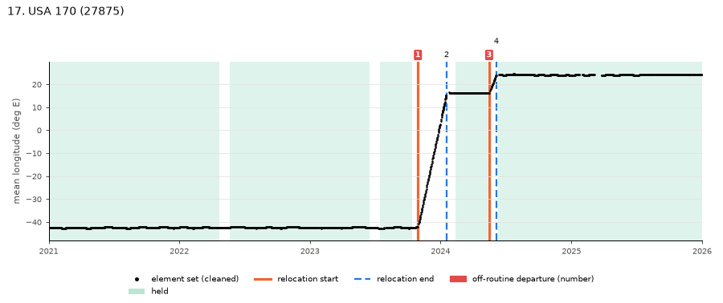

| # | date | type | lon before (deg E) | lon after (deg E) | bits | off-routine | proximity flag |
|---|---|---|---|---|---|---|---|
| 1 | 2023-10-30 | `relocation_start` | -42.46 | 16.182 | 10.23 | yes |  |
| 2 | 2024-01-18 | `relocation_end` | 12.206 | 16.182 |  |  |  |
| 3 | 2024-05-16 | `relocation_start` | 16.182 | 24.25 | 5.341 | yes |  |
| 4 | 2024-06-05 | `relocation_end` | 22.172 | 24.25 |  |  |  |

## 18. USA 164 (27168)

Owner `US`, payload. Held 4.847 years. 3.088 bits per year: 0.0 from the stay model and 3.088 from the rate model. Scored departures 2 (off-routine 2), end of life 0, stay overruns 0, proximity flags 0.

Blind audit: `irregular`; listed departures real: `yes`. Judge's note: After three years at 19 deg it dropped 3 deg to 16.1 deg in March 2024, stayed about four months and drifted back to 19 deg by October 2024.

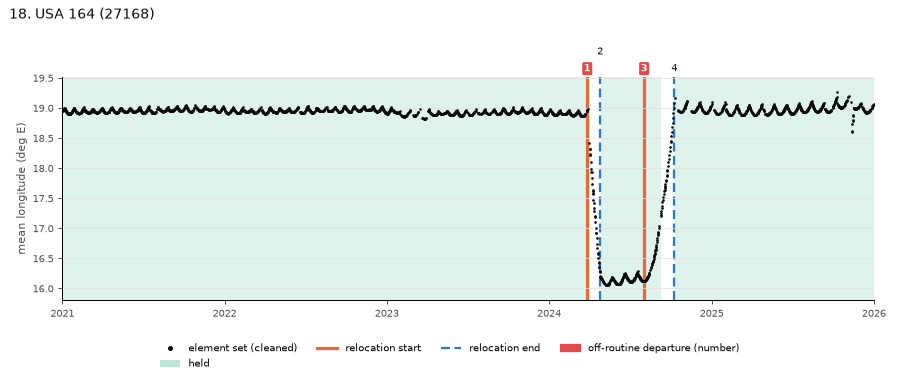

| # | date | type | lon before (deg E) | lon after (deg E) | bits | off-routine | proximity flag |
|---|---|---|---|---|---|---|---|
| 1 | 2024-03-27 | `relocation_start` | 18.931 | 16.126 | 9.858 | yes |  |
| 2 | 2024-04-25 | `relocation_end` | 16.433 | 16.126 |  |  |  |
| 3 | 2024-08-02 | `relocation_start` | 16.203 | 19.046 | 5.572 | yes |  |
| 4 | 2024-10-09 | `relocation_end` | 18.718 | 19.046 |  |  |  |

## 19. EUTE HOT BIRD 13C (HB 9) (33459)

Owner `EUTE`, payload. Held 4.709 years. 3.067 bits per year: 0.0 from the stay model and 3.067 from the rate model. Scored departures 2 (off-routine 2), end of life 0, stay overruns 0, proximity flags 0.

Blind audit: `irregular`; listed departures real: `yes`. Judge's note: It moved from 13 to -12.5 deg in June 2023 at 2.1 deg/day and from -12.5 to -50 deg in late 2025, with the semi-major axis back at GEO after each move.

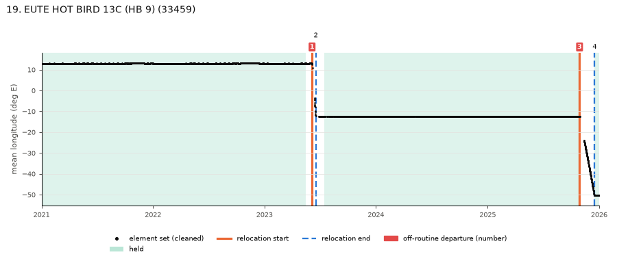

| # | date | type | lon before (deg E) | lon after (deg E) | bits | off-routine | proximity flag |
|---|---|---|---|---|---|---|---|
| 1 | 2023-06-06 | `relocation_start` | 12.989 | -12.523 | 9.406 | yes |  |
| 2 | 2023-06-18 | `relocation_end` | -7.444 | -12.523 |  |  |  |
| 3 | 2025-10-29 | `relocation_start` | -12.509 | -50.299 | 5.925 | yes |  |
| 4 | 2025-12-17 | `relocation_end` | -46.232 | -50.299 |  |  |  |

## 20. GOES 17 (43226)

Owner `US`, payload. Held 4.752 years. 3.066 bits per year: 0.0 from the stay model and 3.066 from the rate model. Scored departures 2 (off-routine 2), end of life 0, stay overruns 0, proximity flags 0.

Blind audit: `irregular`; listed departures real: `yes`. Judge's note: It moved from -137 to -105 deg in January 2023 at 1.15 deg/day and from -105 to -90 deg in June 2025, with holds of two years or more around each move.

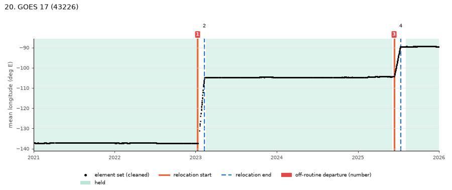

| # | date | type | lon before (deg E) | lon after (deg E) | bits | off-routine | proximity flag |
|---|---|---|---|---|---|---|---|
| 1 | 2023-01-10 | `relocation_start` | -137.259 | -104.557 | 9.473 | yes |  |
| 2 | 2023-02-09 | `relocation_end` | -108.827 | -104.557 |  |  |  |
| 3 | 2025-06-13 | `relocation_start` | -104.557 | -89.495 | 5.85 | yes |  |
| 4 | 2025-07-13 | `relocation_end` | -91.443 | -89.495 |  |  |  |

## 21. SBIRS GEO 4 (USA 273) (41937)

Owner `US`, payload. Held 4.177 years. 3.065 bits per year: 0.0 from the stay model and 3.065 from the rate model. Scored departures 2 (off-routine 2), end of life 0, stay overruns 0, proximity flags 0.

Blind audit: `irregular`; listed departures real: `yes`. Judge's note: It moved from -160 to -100 deg in March 2023 at 2.8 deg/day and then drifted west across the date line from January to September 2025 to settle near +20 deg.

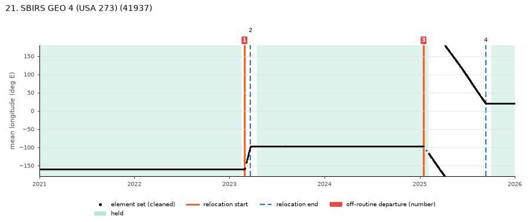

| # | date | type | lon before (deg E) | lon after (deg E) | bits | off-routine | proximity flag |
|---|---|---|---|---|---|---|---|
| 1 | 2023-02-28 | `relocation_start` | -159.397 | -96.766 | 9.602 | yes |  |
| 2 | 2023-03-23 | `relocation_end` | -107.416 | -96.766 |  |  |  |
| 3 | 2025-01-16 | `relocation_start` | -96.811 | 20.927 | 5.717 | yes |  |
| 4 | 2025-09-12 | `relocation_end` | 24.888 | 20.927 |  |  |  |

## 22. EWS-G3 (GOES 14) (35491)

Owner `US`, payload. Held 4.671 years. 3.065 bits per year: 0.0 from the stay model and 3.065 from the rate model. Scored departures 2 (off-routine 2), end of life 0, stay overruns 0, proximity flags 0.

Blind audit: `irregular`; listed departures real: `yes`. Judge's note: It stepped 4 deg west from -104.5 to -108.5 deg in February 2023 and left again in December 2025 at -0.63 deg/day with the semi-major axis 50 km high, which is too low to call a graveyard climb.

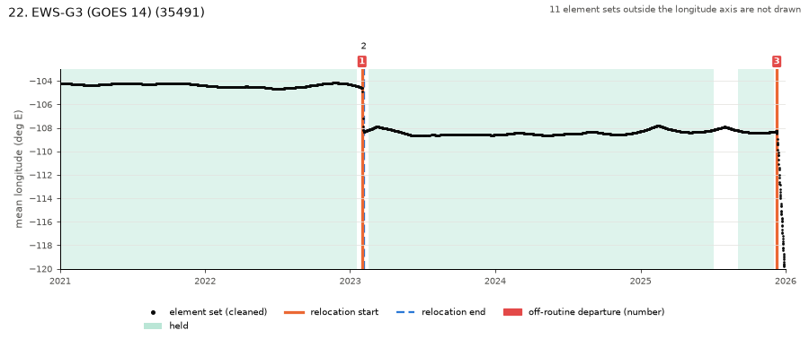

| # | date | type | lon before (deg E) | lon after (deg E) | bits | off-routine | proximity flag |
|---|---|---|---|---|---|---|---|
| 1 | 2023-01-31 | `relocation_start` | -104.314 | -108.027 | 9.382 | yes |  |
| 2 | 2023-02-04 | `relocation_end` | -104.585 | -108.027 |  |  |  |
| 3 | 2025-12-10 | `relocation_start` | -108.332 | -118.879 | 5.935 | yes |  |

## 23. FENGYUN 4B (48808)

Owner `PRC`, payload. Held 4.27 years. 3.055 bits per year: 0.0 from the stay model and 3.055 from the rate model. Scored departures 2 (off-routine 2), end of life 0, stay overruns 0, proximity flags 1.

Blind audit: `irregular`; listed departures real: `yes`. Judge's note: It moved about 10 deg east in March 2022 and about 28 deg west to 105 deg in February 2024, with holds of nearly two years after each.

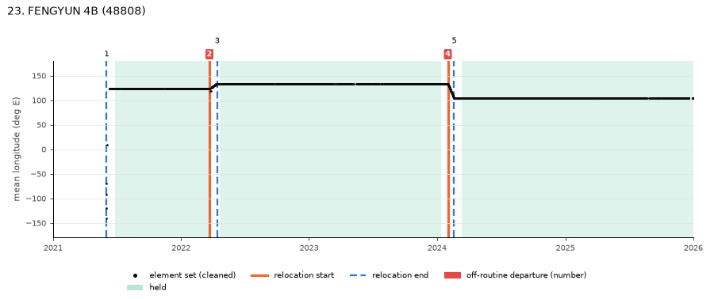

| # | date | type | lon before (deg E) | lon after (deg E) | bits | off-routine | proximity flag |
|---|---|---|---|---|---|---|---|
| 1 | 2021-06-03 | `relocation_end` | -91.991 | 123.72 |  |  | yes, near 42815 |
| 2 | 2022-03-23 | `relocation_start` | 123.373 | 133.129 | 8.678 | yes |  |
| 3 | 2022-04-14 | `relocation_end` | 131.13 | 133.129 |  |  |  |
| 4 | 2024-02-01 | `relocation_start` | 132.923 | 104.614 | 5.118 | yes |  |
| 5 | 2024-02-19 | `relocation_end` | 111.755 | 104.614 |  |  |  |

## 24. TDRS 8 (26388)

Owner `US`, payload. Held 4.423 years. 3.029 bits per year: 0.0 from the stay model and 3.029 from the rate model. Scored departures 2 (off-routine 2), end of life 0, stay overruns 0, proximity flags 0.

Blind audit: `irregular`; listed departures real: `yes`. Judge's note: After two and a half years at 88 deg it crossed the date line to -170 deg in July 2023 at 2.9 deg/day, held about 19 months and returned to 85 deg between April and July 2025.

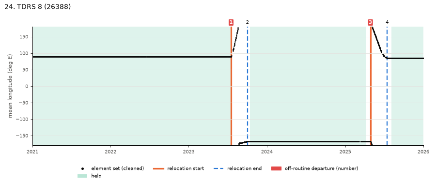

| # | date | type | lon before (deg E) | lon after (deg E) | bits | off-routine | proximity flag |
|---|---|---|---|---|---|---|---|
| 1 | 2023-07-18 | `relocation_start` | 89.32 | -167.723 | 9.398 | yes |  |
| 2 | 2023-10-02 | `relocation_end` | -168.623 | -167.723 |  |  |  |
| 3 | 2025-04-29 | `relocation_start` | -167.663 | 84.762 | 5.741 | yes |  |
| 4 | 2025-07-16 | `relocation_end` | 86.305 | 84.762 |  |  |  |

## 25. METEOSAT 12 (MTG I1) (54743)

Owner `EUME`, payload. Held 2.874 years. 2.999 bits per year: 0.0 from the stay model and 2.999 from the rate model. Scored departures 1 (off-routine 1), end of life 0, stay overruns 0, proximity flags 0.

Blind audit: `irregular`; listed departures real: `yes`. Judge's note: After arriving in December 2022 it held near -3 deg for about 13 months and then stepped about 3 deg east to 0 deg in January 2024, where it has stayed.

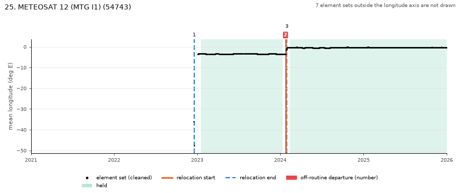

| # | date | type | lon before (deg E) | lon after (deg E) | bits | off-routine | proximity flag |
|---|---|---|---|---|---|---|---|
| 1 | 2022-12-19 | `relocation_end` | -47.608 | -3.405 |  |  |  |
| 2 | 2024-01-24 | `relocation_start` | -3.405 | -0.358 | 8.863 | yes |  |
| 3 | 2024-01-30 | `relocation_end` | -3.563 | -0.358 |  |  |  |

## 26. AEHF 2 (USA 235) (38254)

Owner `US`, payload. Held 4.669 years. 2.899 bits per year: 0.0 from the stay model and 2.899 from the rate model. Scored departures 2 (off-routine 2), end of life 0, stay overruns 0, proximity flags 0.

Blind audit: `irregular`; listed departures real: `yes`. Judge's note: Two real moves after long holds, from -68 to -94 deg in late 2021 and from -94 to -17 deg in mid 2024, each with a drift above 1 deg/day and a semi-major axis offset near 100 km.

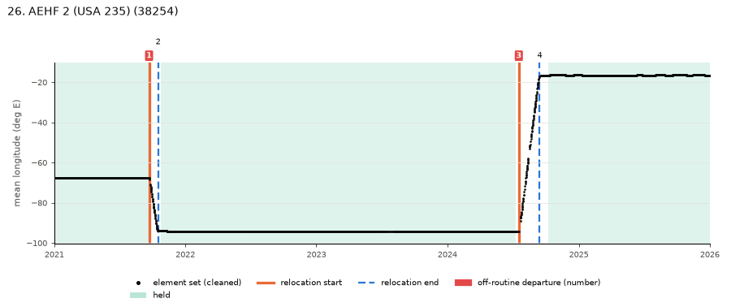

| # | date | type | lon before (deg E) | lon after (deg E) | bits | off-routine | proximity flag |
|---|---|---|---|---|---|---|---|
| 1 | 2021-09-22 | `relocation_start` | -67.615 | -94.113 | 8.945 | yes |  |
| 2 | 2021-10-17 | `relocation_end` | -91.193 | -94.113 |  |  |  |
| 3 | 2024-07-18 | `relocation_start` | -94.113 | -16.498 | 5.544 | yes |  |
| 4 | 2024-09-14 | `relocation_end` | -21.308 | -16.498 |  |  |  |

## 27. XM-4 (29520)

Owner `US`, payload. Held 2.453 years. 2.824 bits per year: 0.0 from the stay model and 2.824 from the rate model. Scored departures 2 (off-routine 1), end of life 1, stay overruns 0, proximity flags 0.

Blind audit: `irregular`; listed departures real: `yes`. Judge's note: It moved from -115 to -85 deg in April 2022 and from -85 to -40 deg in January 2023 before climbing to about 415 km above GEO in October 2023 and drifting away for good.

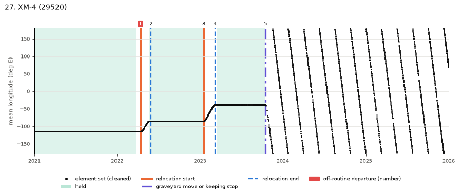

| # | date | type | lon before (deg E) | lon after (deg E) | bits | off-routine | proximity flag |
|---|---|---|---|---|---|---|---|
| 1 | 2022-04-14 | `relocation_start` | -115.254 | -85.134 | 9.243 | yes |  |
| 2 | 2022-05-31 | `relocation_end` | -85.112 | -85.134 |  |  |  |
| 3 | 2023-01-18 | `relocation_start` | -85.134 | -38.977 | 4.87 |  |  |
| 4 | 2023-03-08 | `relocation_end` | -39.704 | -38.977 |  |  |  |
| 5 | 2023-10-17 | `graveyard` | -38.977 | 91.518 |  |  |  |

## 28. HYLAS 1 (37237)

Owner `UK`, payload. Held 2.753 years. 2.777 bits per year: 0.869 from the stay model and 1.908 from the rate model. Scored departures 12 (off-routine 0), end of life 0, stay overruns 0, proximity flags 0.

**Not judged irregular by the blind audit: `rhythm`.**

Blind audit: `rhythm`; listed departures real: `yes`. Judge's note: Thirteen real moves of tens of degrees start every three to six months from April 2021 to September 2025, each followed by a hold of two to four months.

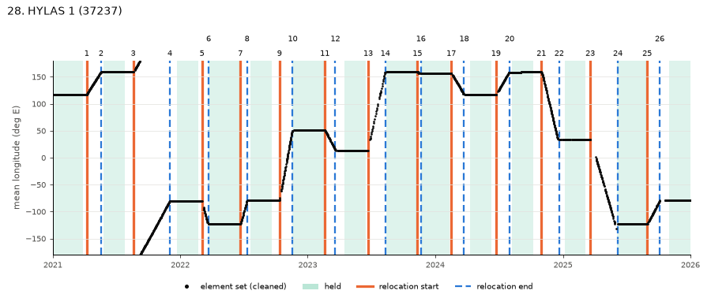

| # | date | type | lon before (deg E) | lon after (deg E) | bits | off-routine | proximity flag |
|---|---|---|---|---|---|---|---|
| 1 | 2021-04-08 | `relocation_start` | 117.26 | 158.746 | 7.721 |  |  |
| 2 | 2021-05-19 | `relocation_end` | 153.719 | 158.746 |  |  |  |
| 3 | 2021-08-19 | `relocation_start` | 158.746 | -80.803 | 4.158 |  |  |
| 4 | 2021-12-02 | `relocation_end` | -85.475 | -80.803 |  |  |  |
| 5 | 2022-03-04 | `relocation_start` | -80.803 | -123.237 | 2.772 |  |  |
| 6 | 2022-03-23 | `relocation_end` | -115.522 | -123.237 |  |  |  |
| 7 | 2022-06-22 | `relocation_start` | -123.237 | -79.026 | 2.606 |  |  |
| 8 | 2022-07-11 | `relocation_end` | -88.121 | -79.026 |  |  |  |
| 9 | 2022-10-12 | `relocation_start` | -79.026 | 50.993 | 0.47 |  |  |
| 10 | 2022-11-19 | `relocation_end` | 35.869 | 50.993 |  |  |  |
| 11 | 2023-02-19 | `relocation_start` | 51.714 | 13.803 | 0.463 |  |  |
| 12 | 2023-03-21 | `relocation_end` | 19.548 | 13.803 |  |  |  |
| 13 | 2023-06-23 | `relocation_start` | 13.803 | 159.613 | 0.482 |  |  |
| 14 | 2023-08-11 | `relocation_end` | 151.32 | 159.613 |  |  |  |
| 15 | 2023-11-11 | `relocation_start` | 159.613 | 156.431 | 0.466 |  |  |
| 16 | 2023-11-21 | `relocation_end` | 157.874 | 156.431 |  |  |  |
| 17 | 2024-02-16 | `relocation_start` | 156.431 | 117.199 | 0.517 |  |  |
| 18 | 2024-03-24 | `relocation_end` | 122.642 | 117.199 |  |  |  |
| 19 | 2024-06-23 | `relocation_start` | 117.199 | 158.722 | 0.458 |  |  |
| 20 | 2024-08-01 | `relocation_end` | 154.388 | 158.722 |  |  |  |
| 21 | 2024-10-31 | `relocation_start` | 158.722 | 33.242 | 0.457 |  |  |
| 22 | 2024-12-21 | `relocation_end` | 39.356 | 33.242 |  |  |  |
| 23 | 2025-03-20 | `relocation_start` | 33.242 | -123.353 | 0.464 |  |  |
| 24 | 2025-06-07 | `relocation_end` | -121.24 | -123.353 |  |  |  |
| 25 | 2025-08-30 | `relocation_start` | -123.343 | -79.0 | 0.566 |  |  |
| 26 | 2025-10-05 | `relocation_end` | -85.349 | -79.0 |  |  |  |

## 29. EUTELSAT 10B (54259)

Owner `EUTE`, payload. Held 2.627 years. 2.77 bits per year: 0.0 from the stay model and 2.77 from the rate model. Scored departures 1 (off-routine 1), end of life 0, stay overruns 0, proximity flags 0.

Blind audit: `irregular`; listed departures real: `yes`. Judge's note: After orbit raising ended in April 2023 it stayed about three months near 0 deg and then stepped about 10 deg east in July 2023, where it has been held since.

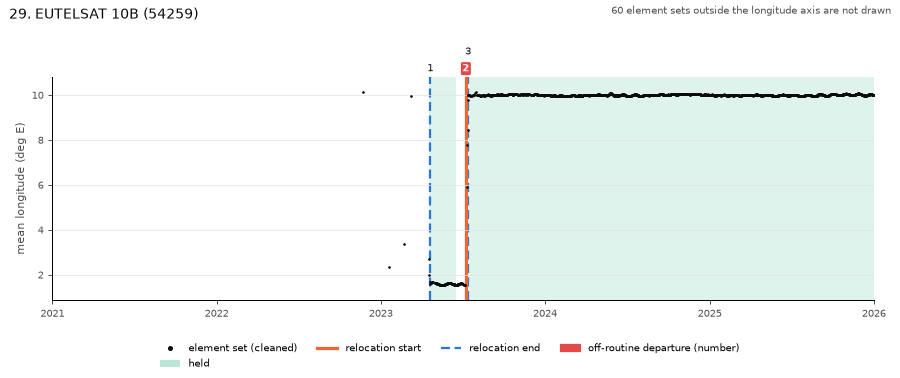

| # | date | type | lon before (deg E) | lon after (deg E) | bits | off-routine | proximity flag |
|---|---|---|---|---|---|---|---|
| 1 | 2023-04-21 | `relocation_end` | 1.983 | 2.121 |  |  |  |
| 2 | 2023-07-09 | `relocation_start` | 1.597 | 10.028 | 7.504 | yes |  |
| 3 | 2023-07-14 | `relocation_end` | 5.897 | 10.028 |  |  |  |

## 30. SBIRS GEO 6 (USA 336) (53355)

Owner `US`, payload. Held 3.12 years. 2.763 bits per year: 0.0 from the stay model and 2.763 from the rate model. Scored departures 1 (off-routine 1), end of life 0, stay overruns 0, proximity flags 0.

Blind audit: `irregular`; listed departures real: `yes`. Judge's note: It arrived near -145 deg in August 2022, held about 14 months, then crossed the date line from October 2023 and settled near +140 deg in January 2024.

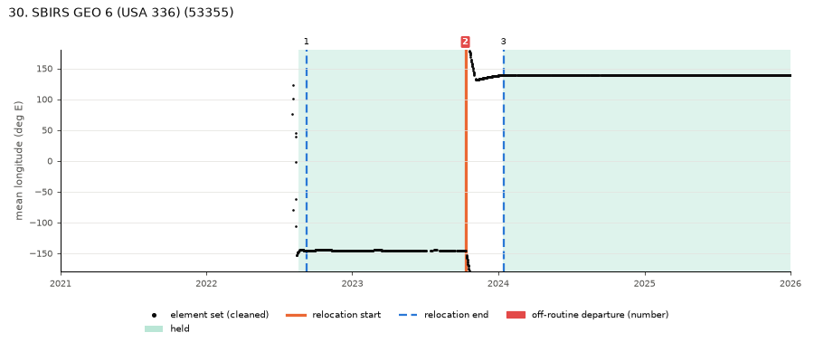

| # | date | type | lon before (deg E) | lon after (deg E) | bits | off-routine | proximity flag |
|---|---|---|---|---|---|---|---|
| 1 | 2022-09-08 | `relocation_end` | -145.007 | -144.826 |  |  |  |
| 2 | 2023-10-11 | `relocation_start` | -144.996 | 138.954 | 9.303 | yes |  |
| 3 | 2024-01-14 | `relocation_end` | 138.916 | 138.954 |  |  |  |
